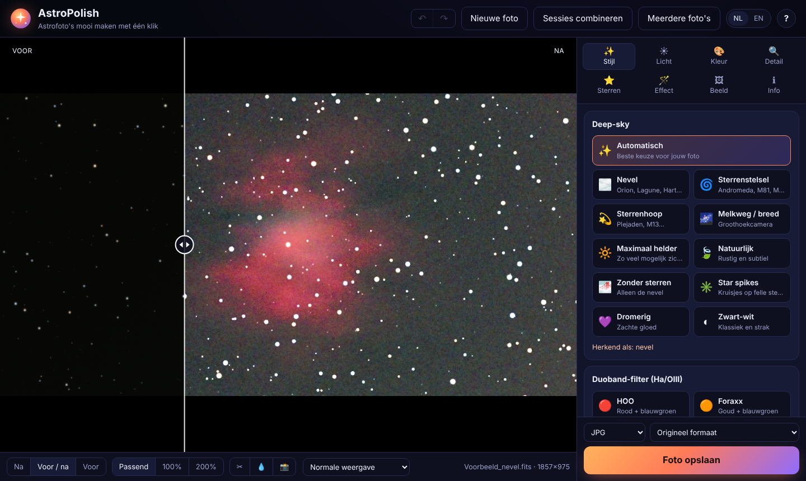

# ✨ AstroPolish

**Astrofoto-editor voor de Dwarf 3 (en andere smart-telescopen), opgezet zoals Adobe Photoshop: menubalk, gereedschappen, optiebalk, documenttabs en panelen, met niet-destructieve aanpassingslagen.**
Foto erin slepen en je krijgt meteen een complete automatische bewerking, opgebouwd uit lagen die je allemaal nog kunt aanpassen, verbergen, maskeren en mengen.

**Twee modi** (rechtsboven te wisselen):
- **Eenvoudig** (standaard voor nieuwe gebruikers): drie stappen. Foto openen, stijl kiezen, eventueel een paar schuifjes in gewone taal (helderheid, contrast, kleur, koel/warm, lichtvervuiling, ruis, sterren kleiner, scherpte) en opslaan. Geen lagen of gereedschappen in beeld.
- **Expert**: de volledige Photoshop-werkruimte hieronder. Elke laag heeft een korte uitleg wat hij doet.



**Voor wie?** Voor eigenaren van smart-telescopen (Dwarf 3, Seestar, Vespera…) die zonder kennis van PixInsight of Siril een mooie foto willen, én voor gevorderden die lagen, maskers en astro-specifieke bewerkingen willen gebruiken. AstroPolish bewerkt **gestackte** opnames; het kalibreren en stacken van losse lights, darks en flats doe je in je telescoop-app of in Siril.

## Downloaden

| | |
|---|---|
| 🪟 **Windows-app** | Ga naar [Releases](../../releases/latest) en download `AstroPolish-…-portable.exe` (direct starten, niets installeren) of `AstroPolish-…-setup.exe` (installatieprogramma met snelkoppeling). |

> Windows SmartScreen kan bij de eerste keer waarschuwen omdat de app (nog) niet digitaal ondertekend is. Kies dan *Meer informatie* → *Toch uitvoeren*.

## Alles wat erin zit

**Photoshop-werkruimte.**
- Menubalk (Bestand, Bewerken, Afbeelding, Laag, Selecteren, Filter, Astro, Weergave, Venster, Help) met de bekende Photoshop-sneltoetsen (Ctrl+L, Ctrl+M, Ctrl+U, Ctrl+B, Ctrl+J, Ctrl+Z…).
- Gereedschapsbalk: verplaatsen, hand, zoom, rechthoek- en ovaalselectie, bijsnijden, pipet, sterinfo (FWHM), liniaal/rechtzetten, penseel en gum voor laagmaskers, herstelpenseel (satellietstrepen) en tekst.
- Optiebalk per gereedschap, meerdere documenten in tabbladen, statusbalk met pixelwaarden.
- Panelen: Navigator, Histogram, Info, Eigenschappen, Aanpassingen, Lagen, Geschiedenis (met momentopnamen) en Acties. Panelen aan/uit via *Venster*.

**Lagen.**
- 53 bewerkingen als aanpassingslaag; elke laag heeft dekking, 13 overvloeimodi (bleken, bedekken, zacht licht, kleur, lichtsterkte…) en een masker.
- Maskers op helderheidsbereik, kleurbereik, alleen sterren, alles behalve sterren, object, achtergrond of selectie, plus schilderen met penseel/gum, doezelaar, dichtheid en omkeren. Alt+klik toont het masker.
- Lagen slepen, dupliceren, hernoemen en verbergen. Het origineel blijft altijd onaangetast.
- Projecten opslaan als .json en later weer openen.

**Acties: 19 stijlen met één klik.**
- *Deep-sky*: Automatisch, Nevel, Sterrenstelsel, Sterrenhoop, Melkweg/breed, Maximaal helder, Natuurlijk, Zonder sterren, Star spikes, Dromerig en Zwart-wit.
- *Duoband-filter*: HOO, Foraxx en Hubble-stijl.
- *Zonnestelsel*: Maan, Kleurrijke maan, Zon, Zon oranje (H-alpha-look) en Planeet.
- Je **eigen acties** opnemen, exporteren en importeren. Batchverwerking met elke actie.

**Photoshop-aanpassingen.**
- Helderheid/contrast, niveaus, curven (per kanaal), belichting, levendigheid, kleurtoon/verzadiging, HSL per kleur, kleurbalans, witbalans, fotofilter, zwart-wit, kanaalmixer, negatief, posterize, drempel, verloop toewijzen, schaduwen/hooglichten en automatische tint/contrast/kleur.
- Filters: Gaussiaans vervagen, mediaan, oppervlakte vervagen, minimum, maximum, onscherp masker, hoogdoorlaat, helderheid (clarity), nevel verwijderen (dehaze), CLAHE, reliëf, randen zoeken, korrel, gloed, vignet, stof en krassen.

**Automatisch herkennen en analyseren.**
- Herkent het object via de FITS-header of bestandsnaam (alle 110 Messier-objecten en veel bekende namen), en een maan of zon aan de foto zelf.
- Info-paneel met stackranden, lichtvervuiling, groene zweem, ruisniveau, aantal sterren en scherpte (FWHM), plus de volledige FITS-header.

**Licht.**
- Oprekken met zeven methoden: Automatisch (STF), statistisch, Arcsinh, GHS (Generalized Hyperbolic Stretch), logaritmisch, niveaus en handmatig.
- HDR-multischaaltransformatie.
- Helderheid, zwartpunt, kleurbehoud en HDR-bescherming van felle kernen.
- Contrast, niveaus (zwart/gamma/wit) en een **curves-editor** per kanaal.

**Kleur.**
- Achtergrond neutraliseren en kleurkalibratie op de sterren.
- **Pipet** voor witbalans (witte ster) en voor de achtergrond. Temperatuur en tint.
- **Paletten voor de duoband-filter**: HOO, HOO zacht, Foraxx, Hubble-achtig (SHO-stijl), alleen Ha en alleen OIII, plus OIII-boost.
- Verzadiging, levendigheid en SCNR (groene zweem verwijderen).
- **HSL per tint** (8 kleuren) en **kleurbalans** voor schaduwen, middentonen en hoge lichten.
- Zwart-wit, negatief en inkleuren.

**Detail.**
- Ruisonderdrukking: randbehoudend, wavelets, mediaan of bilateraal. Kleurruis apart, en een gladdere achtergrond.
- Lokaal contrast, verscherpen, **deconvolutie** (Richardson-Lucy) en **6 wavelet-lagen zoals in RegiStax**.

**Sterren.**
- Sterren kleiner, minder fel of helemaal weg (**sterrenloze versie**).
- Sterkleur apart, halo's kleiner en blauwe of paarse randen weg.
- Nevel en sterren gescheiden bewerken.
- **Star spikes** met 4, 6 (JWST-stijl) of 8 stralen.

**Effect.**
- Zachte gloed en vignet.
- **Tekst of watermerk** met automatisch ingevuld object, datum, belichting en telescoop.

**Beeld.**
- **Bijsnijden** met beeldverhoudingen, rechtzetten met elke hoek, draaien en spiegelen.
- 2×2 binning en stackranden automatisch wegsnijden.
- Hete pixels verwijderen.
- Lichtvervuiling weghalen met een gladde (polynoom) of complexe (raster) methode, aftrekken of delen, plus vignetteringscorrectie.

**Info.**
- Histogram (ook logaritmisch), statistieken en ruis.
- Sterren en FWHM.
- Alle FITS-gegevens.

**Bekijken en vergelijken.**
- Voor/na-schuifbalk en **momentopnames** om versies te vergelijken.
- Zoom op 100% en 200%, in volle resolutie berekend.
- Speciale weergaven: sterrenmasker, zonder sterren, gevonden lichtvervuiling en over-/onderbelichting.
- Pixelwaarden onder de muis.
- **Ongedaan maken en opnieuw** (Ctrl+Z / Ctrl+Y).

**Sessies combineren.**
- Stack meerdere nachten van hetzelfde object.
- Automatisch uitlijnen op de sterren (verschuiving en rotatie) en normaliseren.

**Meerdere foto's tegelijk** openen in tabbladen, en batchverwerking.

**Opslaan.**
- Als JPG, PNG, WebP, TIFF 16-bit of FITS 32-bit.
- Formaten: origineel, 4K, 2048 of 1080 px, Instagram 4:5 en 1:1, bureaublad 16:9, telefoon-achtergrond, 2× vergroot, of een voor/na-afbeelding naast elkaar.
- **Instellingen opslaan en laden** als bestand.

**Openen.**
- JPG, PNG en WebP.
- TIFF in 8, 16 of 32 bit: ongecomprimeerd, LZW, Deflate of PackBits.
- FITS in 8, 16 of 32 bit en float: RGB, of Bayer/RAW met debayer.

**Algemeen.**
- Nederlands en Engels. Werkt volledig lokaal: er wordt niets geüpload.

> Sterren verwijderen en ruisonderdrukking werken zonder AI-modellen, zodat de app klein en offline blijft. Op zware data zijn StarNet, GraXpert of de RC-Astro-tools nog sterker.

## Ondersteunde bestandsformaten

| Formaat | Openen | Opslaan | Opmerkingen |
|---|---|---|---|
| FITS | 8, 16 (signed en unsigned met BZERO), 32-bit integer, 32/64-bit float; mono, RGB (3 vlakken) en Bayer (RGGB/BGGR/GRBG/GBRG) | 32-bit float RGB | Ook een afbeelding in een IMAGE-extensie. NaN/Inf worden 0. Niet: gecomprimeerde FITS (fpack), tabellen, data-cubes met meer dan 3 vlakken. |
| TIFF | 8/16-bit unsigned, 32-bit float; mono, RGB, RGBA; ongecomprimeerd, LZW, Deflate (met predictor), PackBits; strips, planar, big- en little-endian | 16-bit RGB (ongecomprimeerd) | Niet: tegels (tiled), BigTIFF, kleurenpalet, signed integers, float-predictor. |
| JPG, PNG, WebP | ja (8-bit, EXIF-oriëntatie) | ja | De browser zet kleurprofielen om naar sRGB. Exports bevatten geen ICC-profiel en zijn sRGB. |
| RAW (CR2, NEF, ARW…), HEIC, AVI/SER | nee | nee | Wordt met een duidelijke melding geweigerd. |
| Project (`.astropolish.json`) | ja | ja | Bevat lagen, maskers en geometrie, **niet de foto zelf**: bewaar het naast het originele bestand. |

Maximale afbeeldingsgrootte: 250 megapixel. Een 24 Mpx-export met de automatische bewerking gebruikt ongeveer 1,8 GB werkgeheugen (zie *Prestaties*).

## Status van de functies

**Stabiel (getest met automatische tests):** openen en opslaan van de formaten hierboven, oprekken (STF, statistisch, arcsinh, GHS, log, niveaus, handmatig), lichtvervuiling/gradient, kleurkalibratie, ruisonderdrukking (4 methoden), lagen met dekking, 13 overvloeimodi en maskers, curven, HSL, niveaus en de andere aanpassingen, ongedaan maken/opnieuw, projecten opslaan en laden, export in alle formaten en afmetingen.

**Experimenteel (werkt, maar nog weinig getest op echte opnames):**
- *Sessies combineren*: alleen verschuiving + rotatie (+ schaal), gewoon gemiddelde zonder outlier-rejection, vereist voldoende sterren.
- *Sterren verwijderen / bewerken*: morfologisch, zonder AI. Grote of verzadigde sterren op een heldere nevel laten sporen achter; StarNet of StarXTerminator zijn sterker.
- *Deconvolutie*: Richardson-Lucy met een Gaussische PSF en beschermde achtergrond; versterkt ruis rond sterren een beetje.
- *Debayer*: bilineair; de rijvolgorde volgt ROWORDER/BAYERPAT uit de header, maar is niet met alle camera's gecontroleerd.
- *Herstelpenseel*, *CLAHE* en *HDR multischaal*.

**Bekende beperkingen**
- Het voorbeeld wordt berekend op een verkleinde versie (standaard 1200 px). De export op volle resolutie wijkt gemiddeld ongeveer 1% af (getest: < 2% per preset), omdat ruis op volle resolutie anders reageert op niet-lineaire bewerkingen. Op 100% zoom wordt het uitsnede-gebied op volle resolutie berekend.
- CLAHE berekent zijn tegels per beeld: bij 100%-zoom (uitsnede) kan het lokaal iets anders ogen dan in de export.
- Mono-opnames gebruiken intern drie kanalen (3× geheugen).
- Foutmeldingen van de bestandslezers zijn alleen in het Nederlands.
- De Windows-app is niet digitaal ondertekend (SmartScreen-waarschuwing).
- Er is geen echte kleurbeheer-pipeline (geen ICC-profielen in exports, alles is sRGB).

## Prestaties

Gemeten op een Linux-server (één CPU-kern in de worker, Node 22), automatische bewerking met 12 lagen:

| Afmeting | Voorbeeld | Export volle resolutie | Piekgeheugen |
|---|---|---|---|
| 1920 × 1080 | 1,5 s | 2,9 s | 0,4 GB |
| 3840 × 2160 (Dwarf 3) | 1,4 s | 11,3 s | 0,9 GB |
| 6000 × 4000 (24 Mpx) | 1,6 s | 37,7 s | 1,7 GB |

Een wijziging van één laag rekent alleen die laag en de lagen erboven opnieuw (cache). Alle zware berekeningen draaien in een achtergrondproces, zodat de interface blijft reageren.

## Bugs melden en vragen

Maak een [issue](../../issues/new/choose) aan. Vermeld de versie (*Help → Over AstroPolish*), wat je deed, wat je verwachtte en wat er gebeurde. Bij een foutmelding: klik in het foutvenster op **Details kopiëren** en plak die tekst in het issue. Kun je het bestand delen (bijvoorbeeld via een downloadlink), dan helpt dat enorm. Beveiligingsproblemen: zie [SECURITY.md](SECURITY.md).

## Bijdragen

Bijdragen zijn welkom, zie [CONTRIBUTING.md](CONTRIBUTING.md). Kort: geen nieuwe runtime-dependencies, elke wijziging aan beeldbewerking krijgt een test die aantoont dat het resultaat klopt, en `npm test` moet slagen.

## Tips voor de Dwarf 3

- Gebruik het gestackte **FITS**-bestand als het kan. Daar zit veel meer informatie in dan in de JPG.
- **Duoband-filter**: probeer de stijlen HOO, Foraxx of Hubble.
- **Meerdere avonden** hetzelfde object? Gebruik *Sessies combineren*.
- Een FITS die ondersteboven binnenkomt draai je om via *Afbeelding* → *Afbeelding roteren* → *180°*.
- Satellietstreep? Pak het herstelpenseel (J) en schilder eroverheen.

## Zelf bouwen

```bash
npm install
npm start        # app starten
npm test         # alle Node-tests (lint, formaten, algoritmes, projecten, beveiliging, lagen, stacken)
npm run test:ui  # interfacetest in Chrome (python3 + playwright, server op poort 8765: zie test/README.md)
npm run dist     # Windows .exe bouwen (in dist/)
```

De web-versie staat in de map `app/` en heeft geen build-stap nodig. Start bijvoorbeeld `python -m http.server` in die map.

Elke push en pull request draait alle tests in GitHub Actions en bouwt de Windows-app. Alleen een push naar `main` met een **nieuw** versienummer in `package.json` maakt een release; een bestaande release wordt nooit overschreven.

## Projectstructuur

```
app/              web-app (HTML/CSS/JS, geen dependencies)
  js/engine.js    beeldbewerking: gradient, kleur, stretch, ruis, sterren, wavelets, spikes…
  js/stack.js     sessies uitlijnen (driehoek-matching + RANSAC) en combineren
  js/ops.js       lagen, maskers, overvloeimodi, cache en validatie van projecten
  js/formats.js   FITS- en TIFF-lezer, TIFF16- en FITS-schrijver
  js/core.js      opdrachten voor het achtergrondproces
  js/worker.js    rekent op de achtergrond, zodat de interface soepel blijft
  js/app.js       interface
electron/         Windows-app (main.js) en beveiligingsregels (security.js)
test/             tests; test/fixtures bevat kleine FITS/TIFF-testbestanden (zie test/README.md)
```

---

## Licentie

MIT, zie [LICENSE](LICENSE). De app zelf heeft geen runtime-dependencies. Voor het bouwen van de Windows-app worden Electron (MIT) en electron-builder (MIT) gebruikt.

---

*English:* AstroPolish is a free, open-source astrophoto editor for smart telescopes (Dwarf 3, Seestar, Vespera…) with a Photoshop-style workspace and non-destructive adjustment layers (masks, 13 blend modes, 53 operations). It offers one-click styles plus GHS/arcsinh stretching, gradient removal, colour calibration, HOO/Foraxx palettes, curves, HSL, deconvolution, wavelets, star reduction/removal, star spikes, multi-night stacking, batch processing and many export sizes. Everything runs locally. MIT licence.
