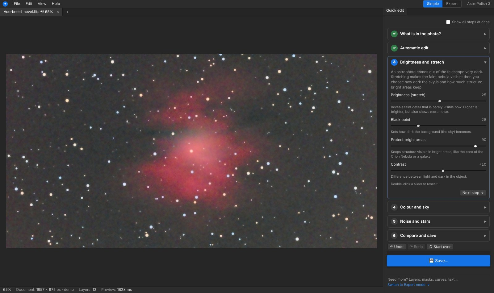

# Simple mode

**English** · [Nederlands](#nederlands)

Simple mode is for people who want a good photo without learning image processing. It is a guided workflow in six short steps, shown as sections on the right. Nothing is forced: you can open any step directly, skip steps, or tick **Show all steps at once** to see every control together (this choice is remembered). Expert mode is one click away and shows exactly the same settings as layers.

## The steps

1. **What is in the photo?** AstroPolish detects the object type (nebula, galaxy, star cluster, Milky Way, Moon, Sun, planet) and shows what it thinks it is. If it is wrong, click the right type; the automatic edit is redone for that type. Tick *dual-band filter* for photos taken with a duo-band filter (HOO palette).
2. **Automatic edit.** The photo is already processed when it opens. Here you can try other styles (natural, maximum bright, starless, HOO…). *Show all styles* lists every preset.
3. **Brightness and stretch.** *Brightness* reveals faint detail, *Black point* sets how dark the sky is, *Protect bright areas* keeps structure in bright cores (only for the automatic stretch), *Contrast*. See [stretch.md](stretch.md).
4. **Colour and sky.** *Remove light pollution*, *Saturation* (only the object and stars become more colourful, not the empty sky), *Cool ↔ warm*.
5. **Noise and stars.** *Reduce noise*, *Smaller stars*, *Sharpness*.
6. **Compare and save.** Hold the button to see the original, before/after split view, zoom to 100%, then save.

Undo, redo and *Start over* (re-apply the chosen style) are always visible under the steps. Double-click any slider to reset it.

## Explanations, tips and warnings

Every slider has a one-line explanation under it (also as a tooltip). Below that, a short message appears when it is useful:

- **💡 Tips** come from the analysis of your photo, for example *"This image is noisy: 0.6–0.75 is recommended"* (low signal-to-noise), *"Clear light pollution was measured"* (strong gradient), or *"In a star cluster the stars are the subject"* (when reducing stars on a cluster).
- **⚠ Warnings** appear when a value is likely to make the photo worse: very strong noise reduction (blurry/"plastic"), saturation above 200 %, strong star reduction (dark rims), heavy sharpening, a very bright stretch (grey sky, more noise), a very high black point (faint detail clipped), or strong light-pollution removal on the Milky Way.

Tips and warnings never change anything by themselves; you decide.

## How it maps to layers

| Simple control | Layer and parameter in Expert mode |
|---|---|
| Brightness (stretch) | Stretch → Brightness |
| Black point | Stretch → Black point |
| Protect bright areas | Stretch → Protect highlights |
| Contrast | Brightness/Contrast → Contrast |
| Remove light pollution | Light pollution / gradient → Amount |
| Saturation | Vibrance → Saturation |
| Cool ↔ warm | Colour calibration → Temperature |
| Reduce noise | Noise reduction → Luminance (colour noise follows) |
| Smaller stars | Star reduction → Amount (or Stars separately → Reduce) |
| Sharpness | Sharpen → Amount |

---

## Nederlands

De eenvoudige modus is voor wie een mooie foto wil zonder beeldbewerking te leren. Het is een begeleide werkwijze in zes korte stappen, rechts als uitklapbare onderdelen. Niets is verplicht: je kunt elke stap direct openen, stappen overslaan of **Alle stappen tegelijk tonen** aanvinken (wordt onthouden). Expert-modus is één klik verder en toont precies dezelfde instellingen als lagen.

**De stappen.** 1 *Wat staat er op de foto?* — het herkende objecttype, met knoppen om het te verbeteren en een vinkje voor duoband-filters. 2 *Automatische bewerking* — andere stijlen proberen. 3 *Helderheid en stretch* — helderheid, zwartpunt, felle delen sparen, contrast. 4 *Kleur en lucht* — lichtvervuiling, verzadiging (alleen object en sterren, niet de lege lucht), koel/warm. 5 *Ruis en sterren* — ruis, sterren kleiner, scherpte. 6 *Vergelijken en opslaan* — origineel vasthouden, voor/na, 100%-zoom, opslaan. Ongedaan maken, opnieuw en *Opnieuw beginnen* staan altijd onder de stappen; dubbelklik op een schuifje zet het terug.

**Uitleg, tips en waarschuwingen.** Elk schuifje heeft een uitleg van één regel. 💡-tips komen uit de analyse van je foto (veel ruis, duidelijke lichtvervuiling, sterrenhoop). ⚠-waarschuwingen verschijnen bij waarden die de foto waarschijnlijk slechter maken (te veel ruisonderdrukking, verzadiging boven 200%, sterk verkleinde sterren, te veel verscherping, te heldere stretch, te hoog zwartpunt, sterke lichtvervuilingscorrectie bij de Melkweg). Tips en waarschuwingen veranderen zelf niets; jij beslist.
